<!-- Banner -->

  

<!-- Texto animado -->

  

<!-- Personaje programando (archivo en la raíz del repo) -->

  

<!-- Insignias -->

  
  
  

  
  
  

---

## 👋 Sobre mí

- 🎓 Egresado en Computación e Informática, apasionado por la tecnología.
- 💼 Desarrollo sistemas a medida de extremo a extremo con **Laravel, React y MySQL**, y aplicaciones móviles.
- 🎯 Doy soluciones prácticas orientadas al usuario, priorizando la funcionalidad y la eficiencia.
- 🌱 Siempre estoy aprendiendo y aplicando nuevas tecnologías para mejorar cada proyecto.

---

## 🛠️ Stack tecnológico

Pasa el cursor sobre cada icono para ver su nombre.

<table align="center">
  <tr>
    <td align="center" width="200"><b>👨‍💻 Lenguajes</b></td>
    <td>
      
      
      
      
      
      
      
      
      
    </td>
  </tr>
  <tr>
    <td align="center"><b>🎨 Frontend</b></td>
    <td>
      
      
      
      
      
      
      
    </td>
  </tr>
  <tr>
    <td align="center"><b>⚙️ Backend</b></td>
    <td>
      
      
      
    </td>
  </tr>
  <tr>
    <td align="center"><b>🗃️ Bases de datos</b></td>
    <td>
      
      
      
      
      
    </td>
  </tr>
  <tr>
    <td align="center"><b>🧰 Herramientas</b></td>
    <td>
      
      
      
      
      
      
      
      
      
      
    </td>
  </tr>
  <tr>
    <td align="center"><b>🤖 IA y automatización</b></td>
    <td>
      
      
      
    </td>
  </tr>
  <tr>
    <td align="center"><b>🛡️ Autenticación y APIs</b></td>
    <td>
      
      
      
      
      
    </td>
  </tr>
</table>

---

## 🚀 Proyectos destacados

<table align="center">
  <tr>
    <td width="33%" valign="top">
      <h3><a href="https://webneonnova.netlify.app/">🎮 NeonNova</a></h3>
      <b>E-commerce gamer</b> 
      Plataforma de comercio electrónico con pagos, autenticación y despliegue cloud.
    </td>
    <td width="33%" valign="top">
      <h3><a href="https://icenterweb.netlify.app/">📱 iCenter</a></h3>
      <b>Tienda tecnológica</b> 
      E-commerce completo con panel de administración, pagos con Stripe, libro de reclamaciones y gestión de inventario.
    </td>
    <td width="33%" valign="top">
      <h3><a href="https://webfitdesk.netlify.app/">🏋️ FitDesk</a></h3>
      <b>Gestión de gimnasios</b> 
      Plataforma integral para centros fitness con gestión de membresías, chatbot con IA y dashboards analíticos.
    </td>
  </tr>
</table>

Explora mis repositorios para ver más proyectos y detalles técnicos.

---

## 📊 Actividad en GitHub

  
  

  

  

---

## 🌱 Aprendiendo ahora

  

- 🧩 Arquitectura de microservicios con Laravel
- 📐 Patrones de diseño avanzados y Clean Code
- 🏛️ Arquitectura Hexagonal y DDD (Domain-Driven Design)
- 🔐 DevSecOps y seguridad en la nube con AWS y Azure
- 🤖 Inteligencia Artificial y Machine Learning con Python
- 📱 Desarrollo móvil cross-platform con Flutter
- ⚡ Optimización de rendimiento y escalabilidad

---

## 💬 Más sobre mí

- 🔭 Desarrollando soluciones empresariales escalables con tecnologías modernas.
- 👯 Busco colaborar en proyectos innovadores con impacto tecnológico y social.
- 💬 Pregúntame sobre: desarrollo web Full Stack, APIs RESTful, buenas prácticas y resolución de problemas.
- 📫 Contacto: [josehuanca612@gmail.com](mailto:josehuanca612@gmail.com)
- 😄 Pronombres: Él / Him
- ⚡ Fun fact: transformo ideas en código funcional.

  

